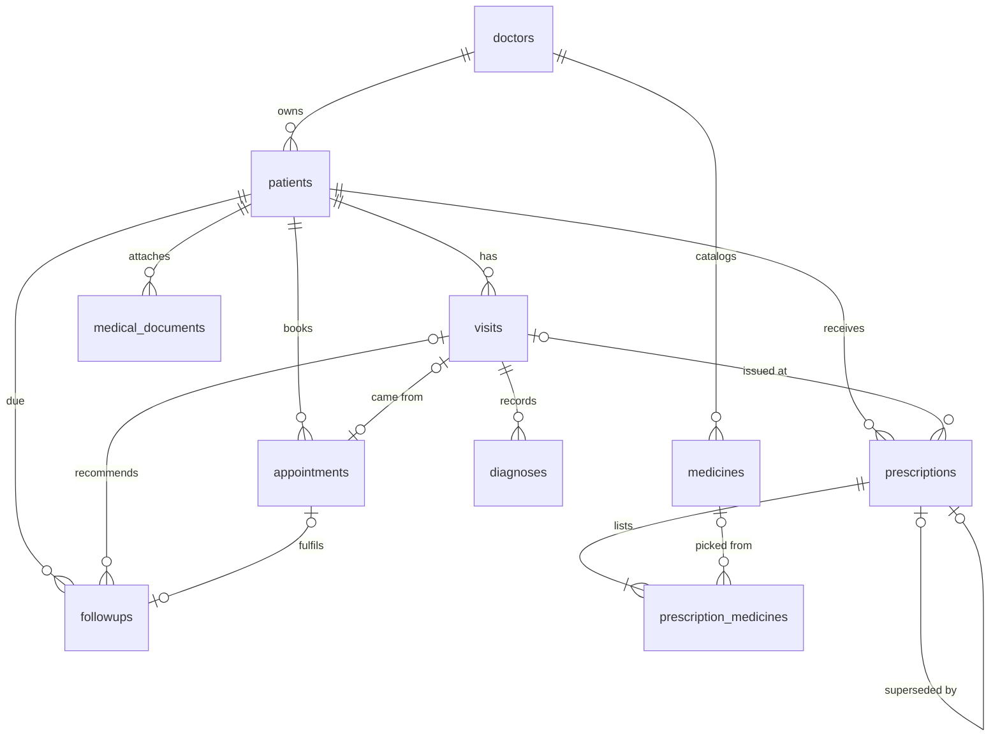

# Data model and schema

The table layout is defined once in `src/data/schema/tables.ts` and drives:

- IndexedDB object stores (one per table, each with a `doctorId` index),
- Excel workbooks (one sheet per table; `data/<table>.xlsx` holds one file per table),
- the generated DDL: [`schema.postgresql.sql`](schema.postgresql.sql) and [`schema.mysql.sql`](schema.mysql.sql) (regenerate with `npm run generate:data`).

Column names are camelCase in the app and Excel, snake_case in SQL. IDs are short prefixed strings (`PT-7K3M9Q`, `RX-24A7KD`) using Crockford base32, so they read aloud without 0/O or 1/I confusion.

## Relationships

Every table except `doctors` carries `doctorId` (the tenant key). All clinical tables except prescriptions and follow-ups carry `deletedAt` for soft deletion; prescriptions use `status` (`Issued`, `Superseded`, `Cancelled`) and follow-ups use `status` (`Pending`, `Scheduled`, `Completed`, `Cancelled`).

## Tables

| Table | Key | Purpose and notable columns |
|---|---|---|
| `doctors` | `doctorId` (Clerk user ID) | Profile and letterhead: specialization, qualifications, registrationNumber, clinic details, signatureFileId, onboardingComplete |
| `patients` | `patientId` | Personal, contact, emergency contact, allergies, conditions, chronic diseases, surgeries, family history, current medications, notes, registrationDate, status, photoFileId |
| `visits` | `visitId` | visitDateTime, visitType, chief complaint, symptoms, vitals (BP systolic/diastolic, heart rate, temperature °F, respiratory rate, SpO₂, weight kg, height cm, BMI), observations, diagnosisSummary (denormalised), treatment plan, notes, followUpDate, appointmentId |
| `diagnoses` | `diagnosisId` | visitId, name, icd10Code, description, symptoms, diagnosisDate, severity, status |
| `prescriptions` | `prescriptionId` | rxNumber (shared across versions), version, status, supersededById, patientId, visitId, prescriptionDate, diagnosis, instructions, followUpDate, editReason, issuedAt, snapshot (JSON of patient and doctor details at issue time) |
| `prescription_medicines` | `id` | prescriptionId, medicineId (nullable: typed-in medicines), name, generic name, strength, dosage, dosageForm, frequency, route, duration, quantity, timing, instructions, sortOrder |
| `medicines` | `medicineId` | name, generic, brand, manufacturer, composition, strength, dosageForm, route, category, description, status |
| `appointments` | `appointmentId` | date, startTime, endTime, type, reason, status, notes, followUpId |
| `followups` | `followUpId` | visitId, dueDate, reason, status, appointmentId, notes |
| `medical_documents` | `documentId` | visitId, name, type, description, uploadDate, fileId, fileName, mimeType, sizeBytes |
| `audit_logs` | `auditId` | entity, entityId, action, detail (field names only), at |

Binary files (documents, photos, signatures) are kept outside the records: in the browser's `files` store today, and in object storage or a `FILE_STORAGE_DIR` on the backend later. Records hold only `fileId`.

## Enumerations

Enumerations are `CHECK` constraints in the DDL and `enum` columns in the Excel validator. Values are defined in `src/domain/constants.ts`:

- Gender: Male, Female, Other
- Blood group: A±, B±, AB±, O±, Unknown
- Visit type: New Consultation, Follow-up, Emergency
- Severity: Mild, Moderate, Severe; diagnosis status: Active, Resolved, Chronic
- Dosage form: Tablet, Capsule, Syrup, Injection, Drops, Cream, Inhaler, Sachet, Other
- Frequency: Once Daily, Twice Daily, Thrice Daily, Four Times Daily, At Bedtime, As Required, Stat (once)
- Timing: Before Food, After Food, With Food, Empty Stomach, Any Time
- Appointment status: Scheduled, Confirmed, Completed, Cancelled, No Show

## Excel import rules

**Settings → Data and storage → Import** replaces the signed-in doctor's workspace with a workbook in the same layout. Before anything is written:

1. Every sheet except `doctors` must be present.
2. Every cell is type-checked against its column (dates `YYYY-MM-DD`, times `HH:MM`, enumerations, numbers, JSON for `snapshot`), required columns must be filled, and primary keys must be unique.
3. Every foreign key must point at a row in the same workbook.
4. `doctorId` in the file is ignored and replaced with the signed-in doctor's ID.
5. IDs that belong to another doctor's workspace in the same storage are refused.

If any check fails nothing is changed, and the first 20 problems are listed by sheet and row.
